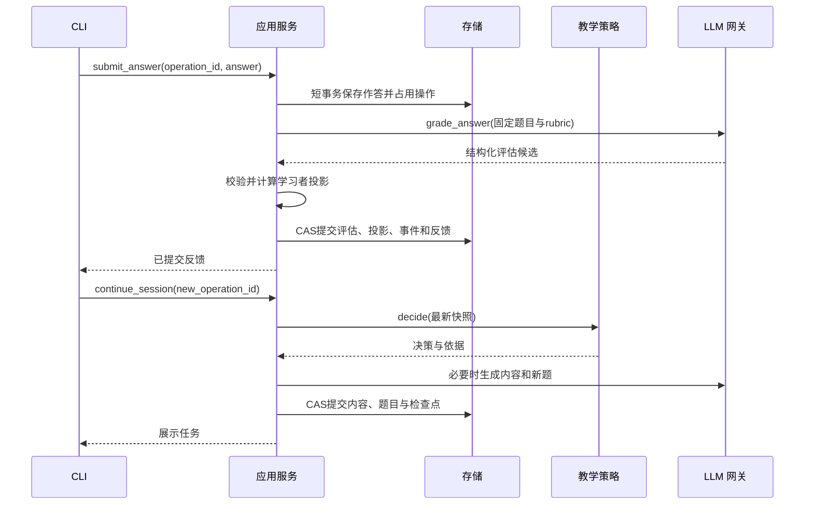

# 模块详细设计索引

状态：已提供 CLI 原型。本文档集保留完整实现契约，实际代码、命令及简化取舍见[原型说明](../prototype.md)，不代表所有目标契约均已实现。

2026-10-20 已同步可替换后端实现：网关、应用服务、CLI、存储配置文档中的“当前实现”小节为本次接口基线。标明“目标”或“后续”的类型化 Facade、Operation、规范化表及完整遥测仍未全部实现。配置操作示例见[模型后端说明](../backends.md)。

## 阅读顺序与规则归属

先阅读[总体设计](../design.md)和[领域规则](../domain-and-policy.md)，再按下表阅读。模块文档细化接口、算法及失败处理；评分阈值、动作枚举等公共规则以领域规则为准，发生冲突时必须同时修订文档，不能在实现中自行选择。

| 文档 | 主要内容 |
|---|---|
| [CLI](cli.md) | 命令、输入状态、展示、取消及退出码 |
| [应用服务](application.md) | 用例、模型调用边界、幂等、恢复和跨模块协调 |
| [教材知识](knowledge.md) | PDF、章节、片段、知识提取、引用与版本发布 |
| [学习者模型](learner.md) | 证据归约、误解、评分修订和复习调度 |
| [教学策略](policy.md) | 依赖规划、动作优先级、补救与停止预算 |
| [LLM 网关](llm.md) | ModelBackend、HTTP/Codex/演示适配、结构化契约和后端预算 |
| [存储与运行配置](storage.md) | schema 3、后端绑定与来源、TOML/环境配置、认证及迁移 |

## 公共约定

- 标明当前实现的接口与代码一致；其余签名为目标设计。当前领域候选采用严格 Pydantic 模型，会话及事件部分采用经应用层控制的字典/JSON，尚未实现全部类型化 ViewModel。
- ID 由程序生成，采用带类型前缀的 UUID，例如 `obj_…`、`q_…`；展示短 ID 必须能唯一解析，否则列出候选，不取第一个。
- 时间使用带时区的 UTC，数据库存规范 ISO 8601；CLI 转换为本地时区。排序增加 ID 作为稳定次序。
- 主键、内容版本和修订号不同：身份标识对象，内容版本标识语义，revision 用于写入冲突控制。
- 本地单用户的 learner_id 固定为 `local`，仍保留该字段隔离未来扩展；第一版不提供多用户身份系统。
- SourceRef = `{chunk_id, start, end, quote}`；start/end 是片段规范文本的 Python 字符索引，采用左闭右开区间。quote 必须与该区间相等。一个片段只属于一个物理页。
- 模型返回候选对象的临时 key，由程序解析为真实 ID；模型不能分配数据库身份或替换会话引用。
- 内容哈希基于 UTF-8 字节或原文件字节；同一操作的输入哈希采用排序键的规范 JSON，不包含密钥及瞬时时间。

## 公共错误契约

`AppError(code, message, retryable, operation_id?, details)` 对 CLI 公开。details 只包含安全的对象 ID、字段名和恢复方式，不包含密钥、完整模型响应或教材正文。领域层抛出领域错误，由应用层转换；存储与网关不直接打印。

| code | 含义 | 默认恢复方式 |
|---|---|---|
| INVALID_INPUT | 参数、命令或标识无效 | 修正输入 |
| NOT_FOUND | 对象不存在 | 查询列表 |
| INVALID_STATE | 当前阶段不允许此动作 | 展示可用命令 |
| POLICY_STALLED | 内部规划无进展或超过步数限制 | 保存并暂停，报告当前目标与原因 |
| CONFLICT | 修订号变化、操作输入不一致 | 重载或复用已提交结果 |
| OPERATION_BUSY | 数据目录已被其他写进程持有 | 退出另一写进程后重试；只读查询可继续 |
| KNOWLEDGE_UNAVAILABLE | 知识未发布或原文不足 | 检查草稿和覆盖缺口 |
| MODEL_UNAVAILABLE | 网络、限流、凭证或服务不可用 | 按错误类型重试或修正配置 |
| MODEL_OUTPUT_INVALID | 契约或语义校验失败 | 预算内修复，否则暂停 |
| STORAGE_ERROR | 写入、磁盘或文件异常 | 保留输入与操作引用后重试 |
| CONFIG_ERROR | 配置或 schema 不兼容 | 修正配置或显式迁移 |

## 完整交互链路

CAS 指“仅当修订号仍等于读取值时更新”。模型调用在数据库事务之外；提示、跳过和暂停也必须经过应用服务更新修订号。

第一版同一数据目录只允许一个写进程，使用操作系统排他锁，不实现租约或心跳。CAS 保留用于过时快照和取消检查。continue 内部可以执行多次 ADVANCE，但在生成一个可交互任务或进入终态后立即返回。
