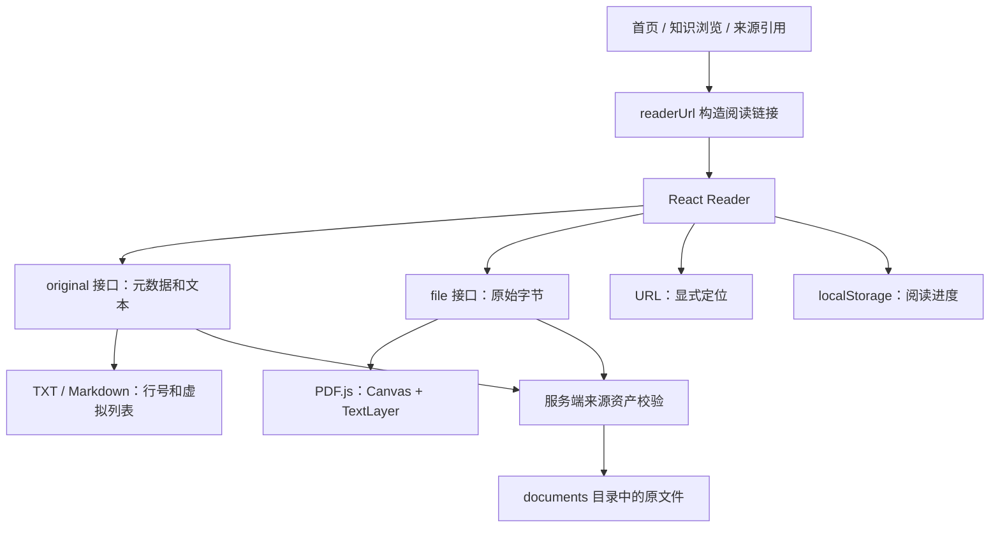

# 应用内阅读器技术笔记

本文以本项目提交 `f337735` 的实现为基础，介绍阅读器的设计、关键技术及当前边界。代码链接均相对于本文所在目录。

## 1. 阅读器在系统中的职责

阅读器负责展示原始教材、导航到引用位置和保存阅读进度。知识抽取负责把教材转成知识点，两者使用同一份来源资产，但有独立的运行流程。

这种分离意味着：打开教材不必等待模型提取；提取失败时仍能阅读原文件；阅读本身不会创建知识候选卡片。

应用内阅读器由应用控制工具栏、定位参数和交互，方便后续接入选区收集、批注及知识卡片。代价是应用需要自行处理渲染性能、资源加载、移动端布局和错误恢复。

## 2. 整体架构



| 层次 | 主要职责 | 实现位置 |
| --- | --- | --- |
| 入口与链接 | 统一生成教材及位置参数，新标签页打开 | [readerLinks.tsx](../web/src/readerLinks.tsx) |
| 阅读器界面 | 加载、导航、缩放、目录、进度 | [Reader.tsx](../web/src/Reader.tsx) |
| 文件服务 | 校验路径、返回元数据与原始字节 | [reader_web.py](../src/teaching_agent/reader_web.py) |
| 静态资源 | Worker、字符映射、字体、WASM | [vite.config.ts](../web/vite.config.ts) |
| 布局 | 桌面双栏、手机折叠目录 | [style.css](../web/src/style.css) |

阅读器通过懒加载单独引入，PDF.js 不必成为首页首次加载的必需代码。

## 3. 原始文件与抽取结果的区别

原始 PDF 包含排版、字体、图形和页面结构。抽取出来的文字只是它的一个投影，不能完整重建原版式。因此“查看原文件”需要读取保存的原始字节，不能用知识块或文字摘录代替。

项目用教材 ID 查找来源资产，用 SHA-256 标识文件内容。SHA-256 在这里用于内容身份和进度隔离；当前读取接口不会每次重新计算文件摘要进行完整性验证。

新数据通过 `asset_path` 定位原文件；旧 PDF 数据没有该字段时，兼容 `documents/{sha256}.pdf`。

## 4. 文件接口与 HTTP

### 4.1 两种接口各司其职

| 接口 | 返回内容 | 用途 |
| --- | --- | --- |
| `GET /api/books/{id}/original` | 文件名、摘要、类型、章节；文本文件额外含正文 | 界面初始化、目录和文本阅读 |
| `GET /api/books/{id}/file` | 原始文件字节 | PDF.js 加载 |
| `GET /api/books/{id}/file?download=true` | 原始文件字节，附件响应 | 下载 |

文本展示会统一换行符，但下载直接返回原始字节，所以原有编码、BOM 和 CRLF 不会因阅读而改变。

### 4.2 Range 请求

HTTP Range 允许客户端请求文件的部分字节。例如：

```http
Range: bytes=0-15
```

有效请求返回 `206 Partial Content`，无效范围返回 `416`。当前使用框架的 `FileResponse` 实现并通过测试验证，避免自行编写字节范围协议。

Range 为 PDF 的分段读取提供条件，但不等于“只下载当前页”：实际请求量还取决于 PDF 文件结构及 PDF.js 的加载行为。

### 4.3 MIME 与下载行为

PDF 返回 `application/pdf`。下载通过 `Content-Disposition: attachment` 指示浏览器保存文件。文本文件原始字节接口使用 `application/octet-stream`，正文通过 JSON 接口进入阅读器。

Worker 的 `.mjs` 必须使用 JavaScript MIME。实现中特别注册了 `text/javascript`，修复 Windows 环境中 `.mjs` 被识别为 `text/plain`、浏览器拒绝加载模块的问题。

## 5. PDF.js 渲染原理

### 5.1 Worker 与主线程

PDF.js 通过 Worker 承担部分 PDF 解析工作。应用主线程负责界面、Canvas 和文本层等工作，因此使用 Worker 能降低解析对交互的影响，但不能消除所有主线程开销。

当前通过 Vite 的 `?url` 导入 Worker 地址，再设置 `GlobalWorkerOptions.workerSrc`。这让构建器管理文件名及资源路径。

### 5.2 Canvas 与 TextLayer

一页 PDF 的显示由两个核心层组成：

- **Canvas**：绘制原始页面的文字外观、图片和图形，保持版式。
- **TextLayer**：在对应位置放置可选择的文本 DOM，使浏览器支持选中文字和复制。

仅绘制 Canvas 不能直接获得浏览器文本选择能力。两层必须使用相同的 viewport、缩放和定位，否则会出现“看见的文字与选区错位”。

扫描 PDF 如果没有文本层，不能直接复制其中的文字；OCR 是独立能力，当前尚未实现。

### 5.3 viewport、缩放与高清屏

`page.getViewport({ scale })` 将 PDF 页面映射为屏幕上的尺寸。适应宽度时，缩放比例由容器宽度与页面原始宽度计算。

高清屏需要区分两个尺寸：

```text
CSS 尺寸 = viewport 尺寸
Canvas 像素尺寸 = viewport 尺寸 × devicePixelRatio
```

本实现将像素倍率限制为最多 2，在清晰度和内存之间取折中。Canvas 的像素数量随倍率平方增长，因此高倍缩放时必须留意内存和绘制时间。

容器宽度由 `ResizeObserver` 监听，窗口调整或移动端布局变化时重新计算适应宽度。

### 5.4 异步任务与清理

用户可能在上一页尚未绘制完成时切换页面。旧任务若继续写入 DOM，就可能显示错误页或产生竞态。

当前 effect 清理会：标记旧任务失效、取消绘制、取消文本层并清空容器；文档卸载时销毁 loading task。错误状态提供重试入口。

当前使用单页渲染，避免同时创建全书 Canvas，但这不代表 PDF.js 内部缓存完全不占用内存。

### 5.5 目录与物理页码

优先读取 PDF 自带书签；书签目标可能是命名目的地或页面对象引用，需要转换为页索引。界面对用户展示从 1 开始的物理页码。

PDF 无可用书签时，使用系统已有章节的起始页作为目录。书上印刷的页码可能与物理页码不同，例如封面和前言会产生偏移；当前引用采用物理页码。

## 6. TXT 与 Markdown 阅读

### 6.1 原文模式

Markdown 在这里作为原始文本显示，不转换成 HTML。这样可以看到标题符号、链接语法和原始行结构，便于核对来源。正文作为 React 文本节点渲染，文本中的 `<script>` 不会作为脚本执行。

编码处理支持 UTF-8、UTF-8 BOM，以及带 BOM 的 UTF-16；不做任意编码猜测。显示时将 CRLF 和 CR 统一为 LF，按逻辑行提供行号。

### 6.2 虚拟列表

长文本如果一次性创建数万行 DOM，会增加布局和滚动成本。虚拟列表保留总高度，只渲染视口附近的行：

```text
offset[0] = 0
offset[i + 1] = offset[i] + height[i]
```

根据 `scrollTop` 找到可见区间，再用绝对定位把这些行放在对应偏移处。跳到第 N 行时，将滚动位置设为 `offset[N - 1]`。

当前长行高度按字符宽度估算，非 ASCII 字符使用较大的宽度权重；关闭换行时行高固定。估算并不等于浏览器实际排版，复杂字符或字体回退可能造成额外留白或定位误差。后续可用实测行高与滚动锚点修正提高精度。

虚拟化只减少 DOM 数量：当前接口仍一次返回全文，前端仍保存完整字符串和行偏移数组。超大文件若成为主要场景，需要进一步引入分段读取和服务端行索引。

## 7. 来源定位和阅读进度

统一链接示例：

```text
/?view=reader&book=BOOK_ID&page=8
/?view=reader&book=BOOK_ID&line=120
/?view=reader&book=BOOK_ID&chunk=CHUNK_ID
/?view=reader&book=BOOK_ID&section=SECTION_ID
```

链接生成优先级为：页码 → 文本行号 → chunk → section。chunk 或 section 需要进一步解析成页码或行号。

打开阅读器时，定位优先级为：

1. 链接明确指定的位置。
2. 当前浏览器保存的阅读位置。
3. 文件开头。

越界位置回到开头并提示。显式引用优先，可以避免点击第 8 页的来源链接却跳到上次阅读的第 30 页。

进度保存在 `localStorage`，键为 `reader:{bookId}:{sha256}`。文件内容变化后不会直接复用旧文件进度。它属于当前浏览器本地状态，不会跨设备同步。

文本滚动进度定期保存，并在 `pagehide` 时尝试保存；URL 同步行号方便刷新。该机制不是持久化事务，浏览器异常退出前的最后瞬间仍可能未保存。

## 8. 文件访问边界

接口接收教材 ID，而不接收客户端传入的任意路径。服务端解析资产路径后，检查：

- 文件摘要字段符合预期格式。
- `documents` 解析后的路径仍在数据根目录下。
- 目标文件解析后的路径位于 `documents` 内。
- 文件确实存在。

使用解析后的路径检查有助于阻止 `../` 路径穿越及指向外部的符号链接。错误响应使用通用提示，不暴露本机绝对路径。

这些检查属于文件访问边界，不能替代多用户鉴权。项目当前是本地单用户应用；若部署为共享服务，还需要教材归属与授权检查。

## 9. 本地资源打包

PDF 渲染依赖的不只是 JavaScript 主包，还包括 Worker、CMaps、标准字体和 WASM 资源。

开发环境由 Vite 中间件提供相关资源；生产构建复制到 `web_static/assets/pdf`，Python 包配置同时包含这些文件。资源随应用分发，不依赖外部 CDN，但这不代表应用已经实现浏览器离线缓存或 PWA。

排查“开发正常、发布后空白”时，需要同时检查资源路径、MIME、构建目录和 Python 打包内容。

## 10. 测试方法与证据

| 层级 | 当前验证内容 |
| --- | --- |
| 后端 | 原始字节不变、附件响应、Range、旧路径兼容、编码处理、越界路径拒绝、Worker MIME |
| 前端单元测试 | 来源链接参数编码与定位优先级 |
| 浏览器测试 | PDF Canvas 和文本层、选区文本、翻页、缩放、目录、进度恢复、越界回退 |
| 长文本测试 | 5000 行文本定位、有限 DOM 行数、脚本字符串不执行、下载字节保持 |
| 布局检查 | 桌面及手机截图、手机页面无横向溢出 |

实现完成时，后端相关测试 19 项、前端测试 15 项、阅读器端到端测试 2 项通过，生产构建通过。这些结果说明覆盖场景正常，不代表所有复杂 PDF、加密文件及超大教材都已验证。

测试代码：[后端](../tests/test_reader_web.py)、[链接](../web/src/readerLinks.test.tsx)、[浏览器](../web/e2e/reader.spec.ts)。

## 11. 后续演进：从阅读到知识收集

下一步可以增加“选中文字 → 加入知识收件箱”，继续保持阅读与知识生成的边界。

建议来源记录至少包含教材 ID、文件摘要、来源类型、原文摘录和定位信息。PDF 可先保存物理页码，文本保存起止行；后续精确高亮再增加页面内坐标或文本锚点。

页码与行号用于粗定位，选区坐标用于视觉定位，摘录及上下文用于校验和重新匹配。三者解决不同问题，不应只保存一段没有来源的文字。

当前已经实现文本选择和来源跳转，但还没有把选区转换成候选卡片，也没有实现批注、OCR、精确引用高亮或跨设备进度同步。
